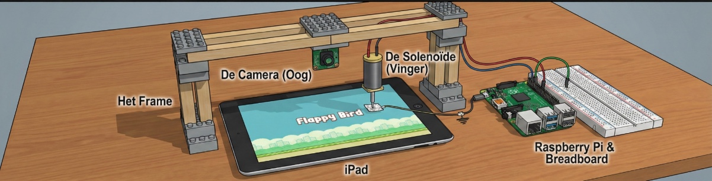
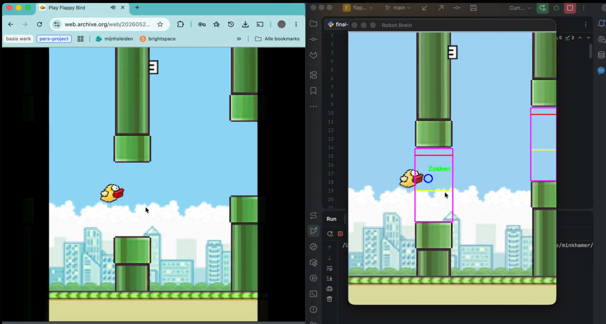
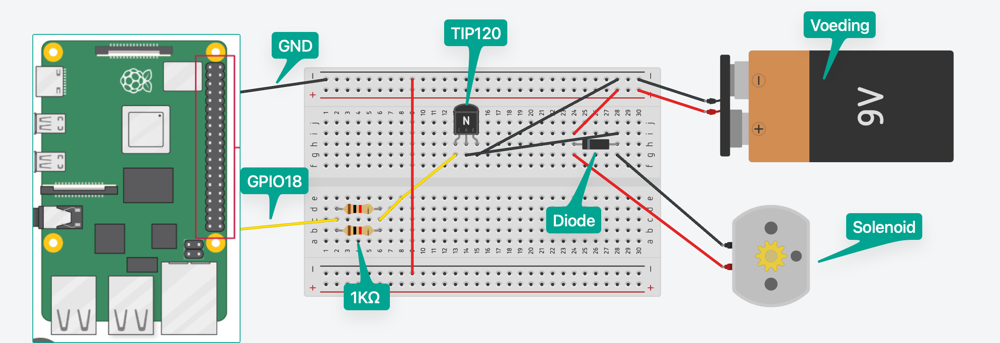
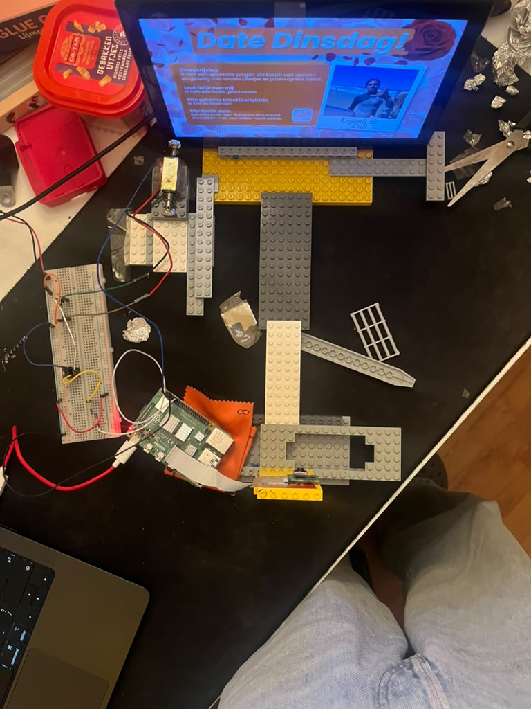
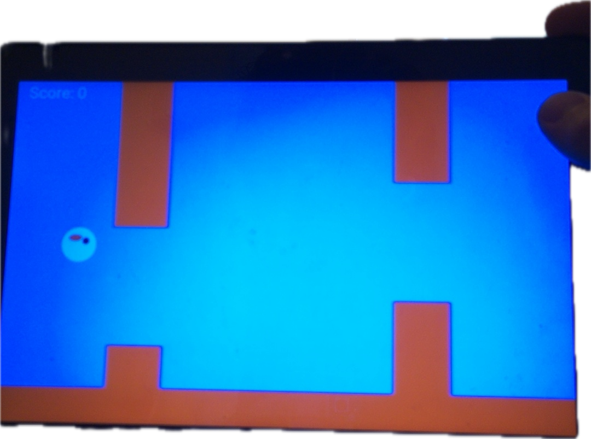

# Devlog: Autonomous Flappy Bird Robot (Hardware-in-the-Loop)

This devlog documents the complete engineering journey of building an autonomous, physical Flappy Bird robot: from an initial 0 ms Computer Vision proof of concept on a laptop to a Raspberry Pi Hardware-in-the-Loop (HIL) rig playing **Turff Flappy** on an upright Turff tablet.

---

## 0. Concept & Initial Plan

The goal was to build a self-contained physical robot capable of playing the game without any API, jailbreak, or access to game memory, relying purely on a camera feed and a physical actuator tapping the screen.

---

## Phase 1: Laptop Proof of Concept

Before investing in hardware, I built a software-only prototype on my laptop to validate whether real-time OpenCV tracking could reliably play the game.

### Static Image Color Profiling
1. I captured a reference frame of the browser-based game (`assets/flappy_test.jpg`) and sampled pixel color values via mouse clicks (green for pipes, white/yellow for the bird).
2. Using `test-cv-on-img.py` (and earlier iterations like `archief/testimg1.py`), I verified that pipe columns and gap centers were accurately detected.

### Real-Time Control Loop (High Score: 90)
Once static detection worked, I built a real-time loop (`final-cv-code-laptop.py`) that continuously captures the game window, projects the bird forward (iterated in `/archief`), and triggers simulated clicks. After tuning the margins, the bot achieved a **high score of 90**. Since the objective was to prove the concept rather than max out the browser version, I moved straight to physical hardware.

<!-- PLACEHOLDER: Save your split-screen screenshot (game + 'Robot Brein' window) as assets/laptop_realtime_demo.jpg -->

### Why I Dropped Machine Learning
I briefly explored a Machine Learning approach (`archief/ml/`), but intentionally abandoned it:
* Training a reinforcement learning agent requires rebuilding Flappy Bird from scratch to run accelerated simulations.
* The target game (**Turff Flappy**) has different, unknown physics (gravity, jump velocity, pipe speed). A model trained on a custom clone would immediately fail on the real iPad. A rule-based CV controller with tunable parameters transfers much better to physical hardware.

---

## Phase 2: Electronics & Mechanical Rig

Moving from a laptop to a standalone **Raspberry Pi 4B** required designing both a safe switching circuit and a mechanical rig capable of tapping a capacitive touchscreen.

### Hardware Specifications
* **Compute:** Raspberry Pi 4B (Raspberry Pi OS Bookworm)
* **Vision:** Raspberry Pi Camera Module 3 (CSI, Phase Detection Autofocus)
* **Actuator:** JF-0530B Push-Pull Solenoid (6V, 300mA)
* **Power:** External 5V/6V DC rail
* **Circuit:** TIP120 Darlington NPN Transistor, 1N4007 Flyback Diode, 2x 1kΩ resistors (base + pull-down), and a capacitive stylus tip with a ground return.

Because Raspberry Pi GPIO pins (~16mA max) cannot drive a 300mA solenoid directly, the TIP120 acts as a low-side switch on GPIO 18, protected by the 1N4007 flyback diode against inductive voltage spikes.

Each subsystem was unit-tested in isolation before integration:
* **Camera capture test:** `raspberrypi/maak_foto.py`.
* **Solenoid test:** `raspberrypi/solenoid_test.py`.

### Two Major Hardware Challenges
1. **Capacitive Screen Rejection:** tablets do not respond to physical pressure; they require electrical conductivity. Wrapping the solenoid tip in aluminum foil was inconsistent. **Fix:** Running a physical **GND wire** directly to the conductive tip so the iPad reliably registers each tap as a human finger.
2. **Pulling Instead of Tapping ("Inverted Solenoid"):** The JF-0530B rests extended and retracts when energized the opposite of what is needed for a quick tap. **Fix:** I mounted the solenoid **rotated 180 degrees**, using the rear shaft protrusion to strike the upright screen on energization, paired with a tensioned rubber band as a return spring. Because the solenoid is relatively weak, the rubber band tension had to be carefully tuned so it wouldn't overpower the magnetic pull.

<!-- PLACEHOLDER: Phone photo of the full vertical rig -> save as assets/physical_setup_overview.png -->

---

## Phase 3: Real-World Computer Vision (Turff Flappy)

Transitioning from a clean laptop screen capture to a physical camera aimed at an iPad running **Turff Flappy** (which features orange pipes and an orange scrolling floor) introduced glare, framing, and noise issues.

### ROI Masking & Color Profiling
Unlike a laptop window, a physical camera captures bezels and background clutter. Using reference captures (`assets/ipad_scherm_test.jpg`, `assets/turffimg.jpeg`) and test scripts (`test-on-turff-img.py`, `test_cv_on_turff-img.py`), I mapped the new HSV ranges for the orange pipes and defined a strict Region of Interest (ROI) to crop out the moving orange floor (`SPEELVELD_BODEM`) and surrounding bezels. Morphological closing (`MORPH_CLOSE`) merges fragmented contours into clean pipe columns.

### Solving Screen Glare via the X-Axis
Reflections on the glass screen occasionally masked the white bird or created false positives.
**Fix:** Because the bird in Flappy Bird stays locked to a fixed horizontal position, the bird detector only scans a narrow vertical corridor (`VOGEL_SCAN_LINKS` to `VOGEL_SCAN_RECHTS`), eliminating the vast majority of background glare.

### Headless Camera Alignment (`kaliberen_camera.py`)
Because the camera is physically taped in place and can shift slightly between sessions, I built `raspberrypi/kaliberen_camera.py`. It hosts a lightweight multithreaded HTTP MJPEG stream (`:8080`) with live ROI overlays, allowing me to verify alignment from any browser over SSH before running a test.

---

## Phase 4: HIL Integration, Latency & Live Tuning (Current Status)

After validating the first closed-loop trigger (`raspberrypi/live_test.py`), everything was merged into the main controller: `raspberrypi/test_cv_and_solenoid.py` (running at 20 FPS).

### The Latency Wall
While the laptop prototype had ~0 ms latency, the physical pipeline (*Camera → OpenCV → GPIO → Solenoid → tablet touch registration*) introduces roughly **150–200 ms of total latency**. The original laptop margins completely broke down: by the time the physical tap lands, gravity has already pulled the bird into the lower pipe or the floor.

### Architecture Upgrades for Rapid Iteration
* **Non-Blocking GPIO State Machine:** Solenoid pulse duration (`KLIK_TIJD`) and cooldown (`MIN_TIJD_TUSSEN_SPRONGEN`) run asynchronously via `time.time()` deltas so frame capture never stalls during a tap.
* **Live Hot-Reloading (`raspberrypi/config.json`):** All thresholds, look-ahead offsets (`VOGEL_OFFSET_X`), and solenoid timings are reloaded on every frame, enabling live tuning over SSH without restarting the script.
* **Ghost Bird Ceiling Protection:** Before firing, the controller predicts the bird's post-jump apex (`vogel_top - SPRONG_KRACHT`) against the upper pipe lip to prevent head-on collisions.
* **Black Box Telemetry (`vlucht_logs/`):** Every run saves a timestamped `.avi` HUD recording (see `assets/vlucht_logboek.avi`) and a `.csv` log so crashes can be analyzed frame by frame.
* **Floor Fail-Safe (`BODEM_REDDING_Y`):** Added a hard floor threshold to force an emergency jump before ground impact. *(Open idea: limit this fail-safe to the opening seconds before the first pipe arrives, then rely purely on pipe targeting.)*

### Demo: Real World vs. Computer Vision
<!-- PLACEHOLDER 1 (Phone POV): Record a short phone video of the physical robot playing and save as assets/demo_phone_pov.mp4 -->
<!-- PLACEHOLDER 2 (Pi HUD POV): Convert the matching vlucht_logs/*.avi recording to MP4 and save as assets/demo_pi_hud.mp4 -->

| Physical Setup (Phone POV) | Robot Vision (Raspberry Pi HUD) |
| :--- | :--- |
|  |  |

---

## Next Step: Automated Calibration

Manual trial-and-error tuning hits a wall when variables like hardware latency, jump height, and look-ahead offset all interact. The next milestone is running an automated calibration script (`raspberrypi/kalibratie_variabelen.py`) that fires taps at a fixed rhythm and mathematically calculates the exact **hardware latency (ms)**, **jump height (px)**, and **fall speed (px/s)** from the camera feed—replacing guesswork with measured constants.