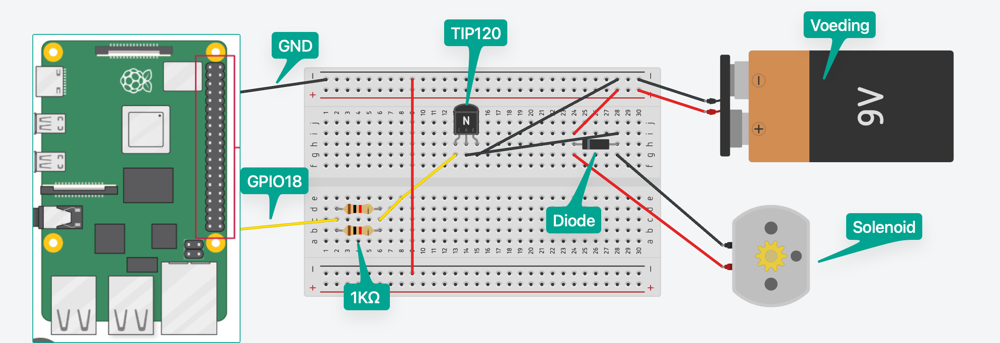

# Build & Setup Guide

This guide covers the hardware components, circuit wiring, mechanical assembly, and software setup required to replicate the Flappy Bird Hardware-in-the-Loop (HIL) robot.

---

## 1. Bill of Materials (BOM)

| Component | Specification                           | Purpose                                            |
| :--- |:----------------------------------------|:---------------------------------------------------|
| **Microcontroller** | Raspberry Pi 4B                         | Runs OpenCV vision loop & GPIO control             |
| **Camera** | Raspberry Pi Camera Module 3 (CSI)      | Captures the iPad screen                           |
| **Actuator** | JF-0530B Push-Pull Solenoid (6V, 300mA) | Physically taps the touchscreen                    |
| **Transistor** | 1x TIP120 Darlington NPN                | Low-side switch for the solenoid                   |
| **Diode** | 1x 1N4007 Flyback Diode                 | Protects the circuit from inductive voltage spikes |
| **Resistors** | 2x 1kΩ                                  | GPIO base current limiting & pull-down             |
| **Power Supply** | External 5V/6V DC rail                  | Powers the 300mA solenoid independently of Pi GPIO |
| **Capacitive Tip** | Conductive stylus tip + GND wire        | Registers taps on a capacitive iPad screen         |
| **Frame / Mount** | LEGO and Tape                           | To build the frame to set everything in position   |


---

## 2. Circuit Wiring

Raspberry Pi GPIO pins can only supply ~16mA, which is not enough to drive a 300mA solenoid. Use a TIP120 transistor as a low-side switch powered by an external 5V/6V supply:



* **GPIO 18 (Pin 12)** → `1kΩ` resistor → **TIP120 Base** (with a second `1kΩ` pull-down resistor from Base to GND).
* **External VCC (5V/6V)** → Positive terminal of the **Solenoid** + **1N4007 Diode Cathode** (striped side).
* **TIP120 Collector** → Negative terminal of the **Solenoid** + **1N4007 Diode Anode**.
* **TIP120 Emitter** → **Common GND** (shared between Raspberry Pi Pin 6 and the external power supply's GND).
* **Capacitive Touch Ground:** Run a wire from Common GND directly to the conductive tip of the solenoid so the iPad registers the touch.

---

## 3. Mechanical Rig

1. **Vertical Alignment:** Mount both the iPad and the Camera Module 3 vertically and parallel to each other to minimize perspective distortion and screen glare.
2. **Inverted Solenoid:** Standard pull-solenoids rest extended and retract when powered. Mount the JF-0530B **rotated 180 degrees** so the rear shaft strikes the screen when energized.

---

## 4. Software Installation

> **OS Note:** This project runs on **Raspberry Pi OS (Bookworm)**. Legacy `cv2.VideoCapture(0)` is no longer supported out-of-the-box for CSI cameras, so `Picamera2` is used to grab frames directly as NumPy arrays.

1. Clone the repository on your Raspberry Pi:
   ```bash
   git clone <YOUR_REPO_URL>
   cd flappybird/raspberrypi
   ```
2. Install the required Python libraries:
   ```bash
   sudo apt update
   sudo apt install -y python3-opencv python3-picamera2 python3-gpiozero python3-numpy
   ```

---

## 5. Testing & Running

Follow this sequence to verify hardware before launching the autonomous loop:

### Step 1: Test the Solenoid
Verify the TIP120 circuit and capacitive touch registration:
```bash
python3 solenoid_test.py
```
The solenoid should tap the screen every 2 seconds. Confirm that the iPad registers every tap.

### Step 2: Align the Camera & ROI
Start the headless calibration stream:
```bash
python3 kaliberen_camera.py
```
Open `http://<RASPBERRY_PI_IP>:8080` in a browser on the same network. Adjust the camera or edit `SPEELVELD_TOP`, `SPEELVELD_BODEM`, and `VOGEL_SCAN_LINKS/RECHTS` in `config.json` until the moving floor is cropped out and the bird stays inside the vertical scan corridor.

### Step 3: Run the Autonomous Controller
Launch the main HIL loop:
```bash
python3 test_cv_and_solenoid.py
```
* **Live Tuning:** Edit `config.json` over SSH while the script is running to adjust `VOGEL_OFFSET_X`, `MARGE_SPRONG`, `KLIK_TIJD`, and `BODEM_REDDING_Y` in real time.
* **Logs:** Every run automatically saves a HUD video (`.avi`) and telemetry log (`.csv`) in `vlucht_logs/`.