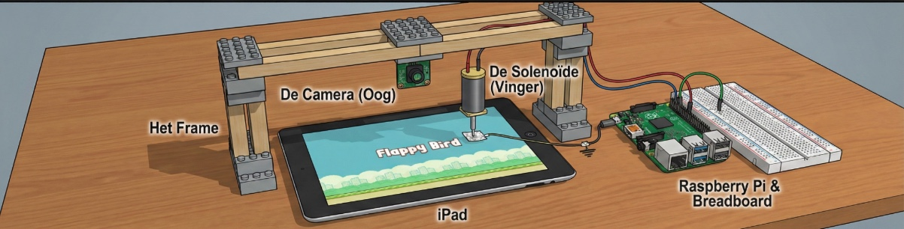

# Flappy Bird Hardware-in-the-Loop Robot - Project Documentatie

Dit document bevat de technische projectomschrijving, de behaalde mijlpalen, het definitieve schakelschema en de benodigde scripts voor de Raspberry Pi 4B Flappy Bird-robot. Deze repository dient als volledige documentatie voor de ontwikkeling van dit autonome systeem.

---

## Introductie van het Project

Dit project betreft de ontwikkeling van een hardware-in-the-loop (HIL) systeem waarbij een Raspberry Pi 4B functioneert als autonome speler voor het spel *Flappy Bird* op een fysieke iPad. 

Het systeem integreert drie kerndisciplines:
1. **Computer Vision (Beeldacquisitie):** Real-time registratie en analyse van het iPad-scherm om spelobjecten (de vogel en buizen) te lokaliseren.
2. **Embedded Logic (Besluitvorming):** Een efficiënt Python-algoritme dat de optimale sprong-timing berekent.
3. **Actuatie (Uitvoering):** Een elektromagnetische solenoid die fysieke input levert op het capacitieve touchscreen.

---

## Projectfasering & Ontwikkeling

De ontwikkeling volgt een iteratieve aanpak, startend bij softwarematige validatie en uitbreidend naar fysieke hardware-integratie.

* **Fase 1: Proof of Concept - Softwarematige validatie (Voltooid)**
  De initiële ontwikkeling vond plaats op een laptop om de beeldverwerkingslogica te valideren. Hierbij is bewust gekozen voor pure Computer Vision (CV) in plaats van Machine Learning (ML). Door middel van gerichte optimalisatie van kleurherkenning en contourdetectie in OpenCV, konden de objecten betrouwbaar worden geïsoleerd in statische beelden (`[JOUW_BESTANDSNAAM_STATISCH].py`). 
  Vervolgens is de codebase uitgebreid naar een real-time implementatie via schermopname (`[JOUW_BESTANDSNAAM_LIVE].py`). Het algoritme stuurde autonoom de spatiebalk van de laptop aan en registreerde de prestatiedata in een logbestand (`[JOUW_BESTANDSNAAM_DATA].csv`) voor verdere analyse. Deze geoptimaliseerde CV-aanpak bleek uiterst effectief en resulteerde in een topscore van 90.(' [beste script]' )

* **Fase 2: Hardware Setup - Vision (Voltooid)**
  De migratie van de vision-architectuur naar de Raspberry Pi. Dit omvatte de integratie van de fysieke Camera Module 3, configuratie van de autofocus-parameters en het valideren van de framerate en latency via een lokaal netwerk.

* **Fase 3: Hardware Setup - Actuatie (Voltooid)**
  Het ontwerpen en simuleren van een veilig schakelcircuit. Het aansturen van een krachtige 6V solenoid vereist strikte scheiding van stroomkringen. Door middel van een transistor en een parallel geplaatste vrijloopdiode is de Raspberry Pi volledig geïsoleerd en beschermd tegen inductieve spanningspieken.

* **Fase 4: Mechanische Constructie (Huidige fase)**
  Het realiseren van de fysieke testopstelling. Het doel is een starre constructie te bouwen om mechanische speling en beeldvervorming door trillingen of externe lichtbronnen te elimineren.

---

## 1. Hardware Specificaties

* **Microcontroller:** Raspberry Pi 4B
* **Vision Sensor:** Raspberry Pi Camera Module 3 (Phase Detection Autofocus via CSI-interface)
* **Actuator:** Solenoid Push-Pull 6V 300mA (JF-0530B)
* **Voeding (Actuator):** Gestripte 2-aderige USB-kabel (via 5V USB-adapter) of een stabiele DC-voedingsbron (bijv. 6V batterij-array).
* **Elektronische Componenten:** * 1x NPN Transistor (bijv. PN2222 of BC547)
  * 1x 1kΩ Basisweerstand (Kleurcode: Bruin-Zwart-Rood)
  * 1x Vrijloopdiode (bijv. 1N4007)
  * 1x Breadboard & bekabeling

---

## 2. Schakelschema & Architectuur

De GPIO-pinnen van de Raspberry Pi zijn niet ontworpen voor het leveren van hoge stromen. Het onderstaande circuit maakt gebruik van een externe voeding waarbij een NPN-transistor fungeert als low-side switch.

### Definitief Circuit


### Bedradingsspecificaties
* **Microcontroller Interface:**
  * **GPIO 18 (Pin 12)** -> Verbonden met de **1kΩ weerstand** -> Base van de transistor.
  * **GND (Pin 6)** -> Verbonden met de gedeelde massa (Common Ground) op het breadboard.
* **Externe Voeding (Power Rail):**
  * **VCC (+)** -> Positieve stroomlijn van het breadboard.
  * **GND (-)** -> Gedeelde massa van het breadboard.
* **Transistor (NPN):**
  * **Collector:** Verbonden met klem B van de solenoid.
  * **Base:** Verbonden met het stuursignaal (via de weerstand).
  * **Emitter:** Verbonden met de gedeelde massa.
* **Inductieve Last & Beveiliging:**
  * **Solenoid Klem A:** Verbonden met de VCC (+).
  * **Vrijloopdiode:** Parallel over de solenoid geplaatst. De kathode (gemarkeerd met streep) is gericht naar de VCC (+) om de flyback-stroom veilig te dissiperen.

---

## 3. Fysieke Opstelling

De betrouwbaarheid van het algoritme is direct afhankelijk van de stabiliteit van de mechanische constructie.

### Overzicht Testopstelling


* **Camera Positionering:** De lens bevindt zich loodrecht boven het display. Externe lichtreflecties zijn geminimaliseerd om interferentie in de kleurdrempels (thresholding) te voorkomen.
* **Actuator Kalibratie:** De solenoid is rigide gemonteerd. De afstand van de stylus-tip tot het capacitieve scherm is gekalibreerd op **1 millimeter** in ruststand. Dit minimaliseert de mechanische vertraging (actuation lag) tussen het GPIO-signaal en de fysieke aanraking.

---

## 4. Hardware Validatie (Scripts)

De onderstaande scripts documenteren de geïsoleerde unittests van de hardware-componenten.

### Test A: Computer Vision Pipeline (`[JOUW_BESTANDSNAAM_CAMERA_TEST].py`)
Validatie van de cameraparameters en de interface met OpenCV op de Raspberry Pi. Dit stelt de autofocus in en capteert een referentieframe voor kleuranalyse.

```python
import cv2
import time

cap = cv2.VideoCapture(0)

if cap.isOpened():
    print("[INFO] Camera stream actief. Autofocus kalibratie...")
    time.sleep(2) # Stabilisatie van de lens
    
    ret, frame = cap.read()
    if ret:
        cv2.imwrite('vision_reference_frame.jpg', frame)
        print("[INFO] Referentieframe opgeslagen voor threshold kalibratie.")
cap.release()