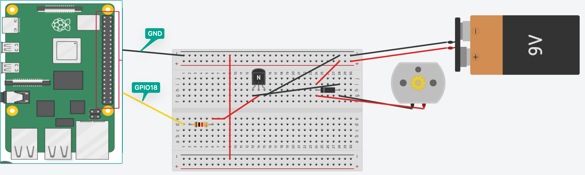

# Flappy Bird Robot - Project Documentatie & Cheatsheet

Dit document bevat de volledige configuratie, het definitieve en veilige schakelschema, en de basisfunctionaliteiten van de Raspberry Pi 4B Flappy Bird-robot.

---

## 1. Hardware Componenten
* **Brein:** Raspberry Pi 4B
* **Ogen:** Raspberry Pi Camera Module 3 (Autofocus via CSI-lintkabel)
* **Spier:** Solenoid Push-Pull 6V 300mA (JF-0530B)
* **Externe Voeding:** Gestripte 2-aderige USB-kabel (verbonden met een veilige 5V USB-muuradapter of powerbank)(kan ook een goede stroombron zijn)
* **Beveiliging & Schakeling:** * 1x NPN Transistor (bijv. PN2222)
  * 1x 1kΩ Basisweerstand (Kleurcode: Bruin-Zwart-Rood)
  * 1x Vrijloopdiode (bijv. 1N4007)
  * 1x Breadboard & Jumper-kabels

---

## 2. Schakelschema & Breadboard Opbouw

Hieronder staat het geteste circuit waarin de Raspberry Pi volledig elektrisch geïsoleerd is van de zware stroom van de solenoid.

### 🖼️ Foto van het Circuit


### 📌 Bedrading Checklist (De Gouden Regels)
* **Raspberry Pi verbindingen:**
  * **GPIO 18 (Pin 12)** -> Sluit aan op de **1kΩ weerstand** -> De andere kant van de weerstand gaat naar de **Base** (middelste pootje) van de transistor.
  * **GND (Pin 6)** -> Sluit aan op de **blauwe min-lijn (-)** van het breadboard (*Common Ground*).
* **Gestripte USB-kabel (Externe Voeding):**
  * **Rode draad (+)** -> Sluit aan op de **rode plus-lijn (+)** van het breadboard.
  * **Zwarte draad (-)** -> Sluit aan op de **blauwe min-lijn (-)** van het breadboard.
* **Transistor (NPN - Platte kant naar voren):**
  * **Links (Collector):** Verbonden met de min-draad van de Solenoid.
  * **Midden (Base):** Verbonden met de 1kΩ weerstand vanaf GPIO 18.
  * **Rechts (Emitter):** Verbonden met de **blauwe min-lijn (-)** van het breadboard.
* **Solenoid & Vrijloopdiode (Parallel):**
  * **Draad A Solenoid:** Sluit aan op de **rode plus-lijn (+)**.
  * **Draad B Solenoid:** Sluit aan op de **Collector** (linker pootje van de transistor).
  * **De Diode:** Prik deze over dezelfde kolommen als Draad A en B. **CRUCIAAL:** Het grijze/zilveren streepje (Kathode) móét naar de **rode plus-lijn (+)** wijzen!

---

## 3. Totale Fysieke Robot Setup

Dit gedeelte is gereserveerd voor de mechanische opbouw. De camera moet recht boven de iPad hangen (vrij van reflecties), en de solenoid moet met een stylus-pen stabiel boven het scherm zweven.

### 📐 Tekening / Foto van de Totale Constructie


* **Camera-hoogte:** Zorg dat het volledige speelveld van de iPad in beeld is zonder dat omgevingslicht reflecteert op het glas.
* **Solenoid-afstand:** Monteer de solenoid zo dat de stylus in ruststand **1 millimeter** boven het scherm zweeft. Hoe korter de afstand, hoe sneller de tik (minder mechanische lag).

---

## 4. Basis Test Scripts (Python)

### Hardware Test: Solenoid (`motor_test.py`)
Maak dit bestand aan met `nano motor_test.py` om te testen of je circuit werkt:

```python
from gpiozero import LED
from time import sleep

# GPIO 18 stuurt de transistor aan
solenoid = LED(18)

print("Robot-vinger paraat... Test start over 2 seconden.")
sleep(2)

try:
    while True:
        print("TIK!")
        solenoid.on()   # Transistor open -> Solenoid vuurt
        sleep(0.1)      # Houdt het scherm 100ms ingedrukt
        
        solenoid.off()  # Transistor dicht -> Veertje trekt pen terug
        print("Wacht...")
        sleep(2.0)      # Wacht 2 seconden voor de volgende tik

except KeyboardInterrupt:
    print("\nTest gestopt door gebruiker.")
    solenoid.off()